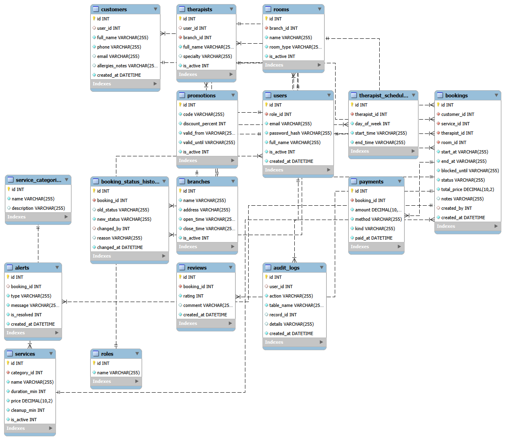

# SPA Booking System (DBMS & SIA)

A web system for booking spa treatments. A booking is only accepted if the therapist, the room and the working hours are all free, including the room cleaning time after each treatment.

**Major feature:** automatic scheduling conflict detection across several resources (therapist + room + schedule + cleanup buffer) with a booking status workflow, automatic late/no-show handling, and cancellation fees.

Stack: Node.js + Express (MVC REST API), MySQL (mysql2), plain HTML/JS

## Group roster and ownership matrix

| Member | GitHub username | Tables | Endpoints / screens | Join report and join type | Feature role |
|---|---|---|---|---|---|
| A: |Joyce_Moycee05| Core | roles, users, customers | `/api/auth`, `/api/users`, `/api/customers`; login, customers.html | users + roles: INNER | Core / security |
| B:|jadaligdig| Master data | branches, service_categories, services | `/api/branches`, `/api/categories`, `/api/services`; branches.html, services.html | categories + services: LEFT | Supports the rules (durations, cleanup time) |
| C: |marie-chan| Transactions | bookings, payments | `/api/bookings`, `/api/payments`; bookings.html | booking details: INNER | Calls the conflict check |
| D: |camy_ky| Unique feature (rules) | therapists, therapist_schedules, rooms | `/api/therapists`, `/api/rooms`, `/api/availability`; availability.html | therapist utilization: LEFT | Conflict detection |
| E: |jerrydevvv| Unique feature (workflow) + Audit | booking_status_history, alerts, audit_logs | `/api/workflow`, `/api/alerts`, `/api/audit`; alerts.html | bookings + alerts: FULL OUTER | Status workflow, alerts, auto no-show |
| F: |Silthia| Reports | reviews, promotions | `/api/reviews`, `/api/promotions`, `/api/reports`; reports.html | service popularity: RIGHT | Dashboard / reporting |

Total: 16 tables. Details of each slice: `docs/SLICE_CARDS.md`. Step-by-step plan: `docs/GUIDE.md`.



## Setup (every member)

1. Install Node.js, MySQL Server and MySQL Workbench.
2. `cd backend` then `npm install`
3. Copy `backend/.env.example` to `backend/.env` and set `DB_PASSWORD` to your own MySQL password. Never commit `.env`.
4. `npm run setup` (drops and rebuilds the `spa_booking` database from `database/schema.sql` and `seed.sql`, and creates the demo users)
5. `npm start`, then open http://localhost:3000/index.html
6. Demo login: `admin@spa.test` / `admin123`

## Rules

- Work on your own branch (for example `member-b-transactions`) and open a pull request into `main`.
- Only edit your own slice's files. Tell Member B before changing `config/db.js`, `schema.sql`, `seed.sql`, `setup.js`, `audit.js` or `users.model.js`.
- Models use `async/await` with `db.query` (mysql2), never `db.prepare`.
- After anyone changes `schema.sql` or `seed.sql`, everyone pulls and runs `npm run setup` again.

## How to run

Requires **Node.js 22.13 or newer** (24 LTS recommended).

```
cd backend
npm install
copy .env.example .env        # Mac/Linux: cp .env.example .env
npm run setup                 # builds the database from schema.sql + seed.sql (wipes old data)
npm start                  # http://localhost:3000
```

Demo logins: `admin@spa.test / admin123`, `reception@spa.test / reception123`, `customer@spa.test / customer123`.

## Folder structure

```
spa-booking-sia/
├─ README.md
├─ .gitignore
├─ docs/
│  ├─ GUIDE.md                step-by-step plan
│  ├─ SLICE_CARDS.md          what each member builds
│  └─ er-diagram.png          (add before the deadline)
├─ backend/
│  ├─ app.js                  starts the server
│  ├─ package.json
│  ├─ .env.example
│  ├─ config/db.js            database connection
│  ├─ database/               schema.sql, seed.sql, setup.js
│  ├─ middleware/             auth.js (401/403), errorHandler.js (404/500)
│  ├─ utils/                  respond.js (JSON format), audit.js
│  ├─ models/                 *.model.js       SQL + validation
│  ├─ controllers/            *.controller.js  request/response + status codes
│  └─ routes/                 *.routes.js      URL → controller (auto-loaded)
└─ frontend/
   ├─ index.html              login
   ├─ branches.html ...       one screen per slice
   ├─ css/style.css
   └─ js/api.js, nav.js       shared fetch helper + menu
```

## API response format

```json
{ "success": true,  "message": "Branch created", "data": { } }
{ "success": false, "message": "Validation failed", "errors": ["name must be at least 2 characters"] }
```

Status codes: 200 OK, 201 Created, 400 validation/bad input, 401 not logged in, 403 not allowed, 404 not found, 409 booking conflict, 500 server error.

## Endpoints

Provided in the starter: `POST /api/auth/login`, `GET /api/auth/me`, and full CRUD on `/api/branches` (GET list, GET by id, POST, PUT, DELETE).
Each member adds their endpoints here as they finish them:

| Method | URL | Owner | Notes |
|---|---|---|---|
| GET | /api/users/report/with-roles | A | INNER JOIN |
| GET/POST/PUT/DELETE | /api/customers | A | |
| GET/POST/PUT/DELETE | /api/services | B | |
| GET | /api/services/report/by-category | B | LEFT JOIN |
| GET/POST/PUT/DELETE | /api/bookings | C | create returns 409 on conflict |
| GET | /api/bookings/report/details | C | INNER JOIN |
| GET/POST/PUT/DELETE | /api/therapists | D | |
| GET | /api/availability | D | free slots |
| GET | /api/therapists/report/utilization | D | LEFT JOIN |
| PATCH | /api/workflow/bookings/:id/status | E | allowed transitions only |
| GET/POST/PATCH/DELETE | /api/alerts | E | |
| GET | /api/alerts/report/booking-alerts | E | FULL OUTER JOIN |
| GET/POST/PUT/DELETE | /api/promotions | F | |
| GET | /api/reports/service-popularity | F | RIGHT JOIN |
| GET | /api/reports/dashboard | F | |
