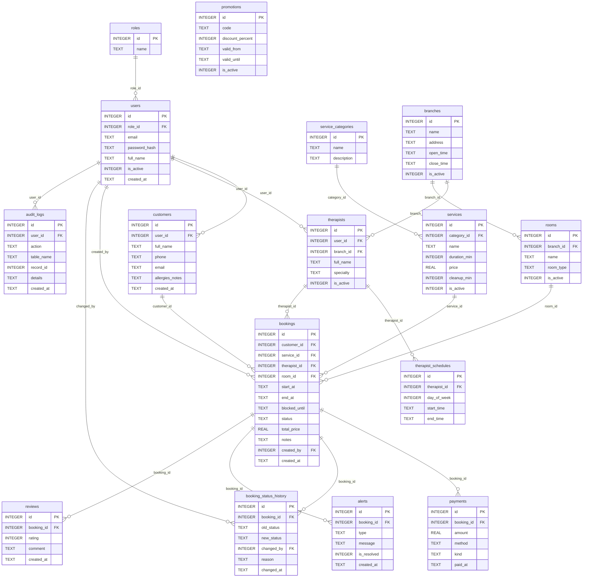

# Finish the Team Deliverables (about 30 minutes, split between members)

Put these three files from the download into the repo's `docs/` folder: `er-diagram.png`, `list-endpoints.js`, and this file. Commit them on a branch like any other change.

---

## 1. ER diagram (5 minutes, one person)

1. Copy `er-diagram.png` into `docs/`.
2. **Check it against your real MySQL schema.** The diagram was drawn from the 16-table design in the starter. Open the schema file the team actually runs in `backend/database/` and compare table and column names. If a teammate renamed or added a column, tell the group, and edit the diagram.
3. In `README.md`, add under the title:

```
## ER diagram

```

GitHub can also draw the diagram from text. Paste this block into `README.md` as an alternative, or use both:



---

## 2. Endpoint list (5 minutes, after everyone has merged their routes)

1. Everyone pulls `main` first, so every `*.routes.js` file is on your computer.
2. In the terminal, at the project root (the folder containing `backend`, not inside it):

```
node docs/list-endpoints.js
```

3. It prints a table (Method, URL, who can use it, handler). Copy it and paste it into `README.md` under a heading `## Endpoints`, replacing the planned table.
4. Add the join reports by hand in a short list (which endpoint, which join type, which member):

| Join | Endpoint | Member |
|---|---|---|
| INNER | `GET /api/users/report/with-roles` | A |
| LEFT | `GET /api/services/report/by-category` | B |
| INNER | `GET /api/bookings/report/details` | C |
| LEFT | `GET /api/therapists/report/utilization` | D |
| FULL OUTER | `GET /api/alerts/report/booking-alerts` | E |
| RIGHT | `GET /api/reports/service-popularity` | F |

Edit the URLs to match what each member really built. The script only reads route files, so a route that isn't merged yet won't appear.

---

## 3. How to run it with MySQL (paste into README.md)

Everything below assumes the team database is MySQL. **Check two things before you paste it:** the database name your team uses, and the variable names in `backend/.env.example`. Replace the placeholders.

```markdown
## How to run (MySQL)

### One-time setup
1. Install Node.js 24 LTS and MySQL (XAMPP is fine: start **MySQL** in the XAMPP Control Panel).
2. Clone the repo and open a terminal in the `backend` folder:
   ```
   npm install
   copy .env.example .env
   ```
3. Open `.env` and fill in the values shown in `.env.example` (database name, user, password).
   With XAMPP the user is usually `root` and the password is empty.
4. Create the database and load the tables and sample data. Use **one** of these:
   - **phpMyAdmin** (http://localhost/phpmyadmin): New → database name `spa_booking` → Create → Import → choose
     `backend/database/schema.sql` → Go, then the same for `backend/database/seed.sql`.
   - **Command line** (XAMPP: `C:\xampp\mysql\bin`):
     ```
     mysql -u root -p -e "CREATE DATABASE spa_booking"
     mysql -u root -p spa_booking < database/schema.sql
     mysql -u root -p spa_booking < database/seed.sql
     ```
5. Create the demo users if the project has a script for it (for example `npm run setup`). Otherwise use the login created by the seed data.

### Every day
```
cd backend
npm run dev
```
Open http://localhost:3000 and log in with the demo account listed in the README.
```

If a teammate still has the old SQLite file (`spa.db`), they can delete it. It is not used anymore.

---

## 4. FULL OUTER JOIN in MySQL (Member E)

MySQL has no `FULL OUTER JOIN` keyword. The standard replacement is a `LEFT JOIN` joined by `UNION` to a `RIGHT JOIN`. This shape was tested (SQLite accepts the same syntax) and returns a booking with no alert, an alert with no booking, and matched pairs:

```sql
SELECT b.id AS booking_id, b.status, a.id AS alert_id, a.type
FROM bookings b LEFT JOIN alerts a ON a.booking_id = b.id
UNION
SELECT b.id, b.status, a.id, a.type
FROM bookings b RIGHT JOIN alerts a ON a.booking_id = b.id
```

`UNION` (not `UNION ALL`) removes the duplicate rows for bookings that do have alerts. Be ready to explain this at the defense: "MySQL doesn't support FULL OUTER JOIN, so I combined a LEFT and a RIGHT JOIN."

---

## 5. Final checklist before the deadline

- [ ] README: roster and ownership matrix (done), how to run (MySQL), ER diagram, endpoint list, join report list
- [ ] SQL script(s) in `backend/database/` (schema and seed), plus `.env.example` committed, no `.env`
- [ ] Every member: at least one merged pull request and at least one review given
- [ ] `git shortlog -sne --no-merges --all` shows all 6 members, with matching GitHub emails
- [ ] Everything merged into `main`, and `main` runs on a fresh clone (try it on one other laptop)
- [ ] Each member has rehearsed their defense: one file explained line by line, plus one live change
